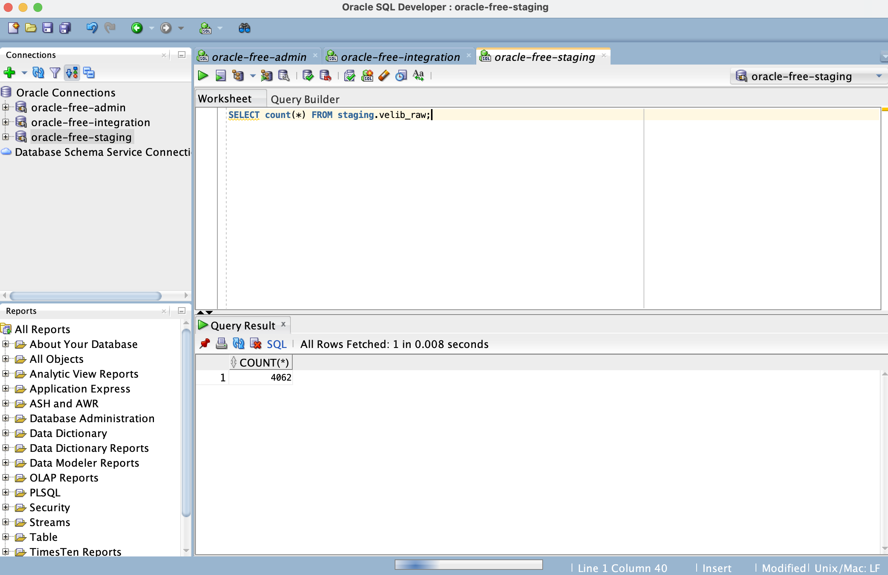
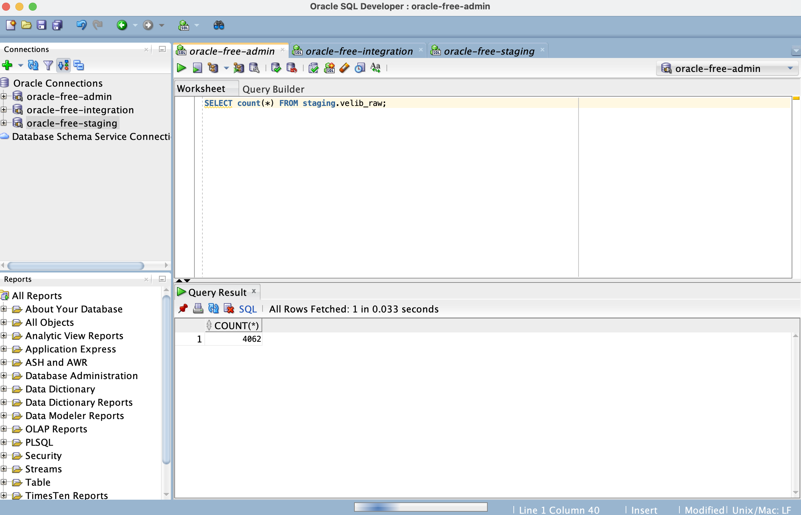
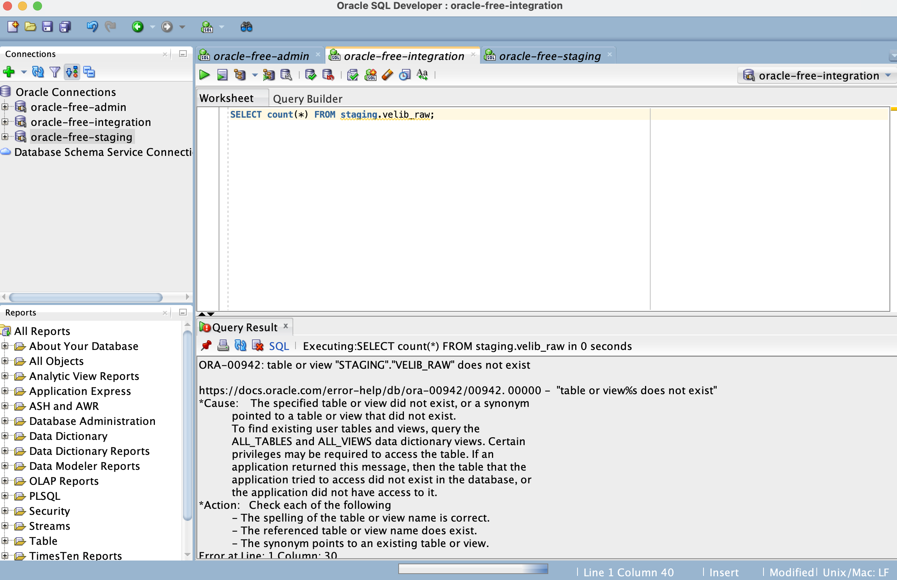
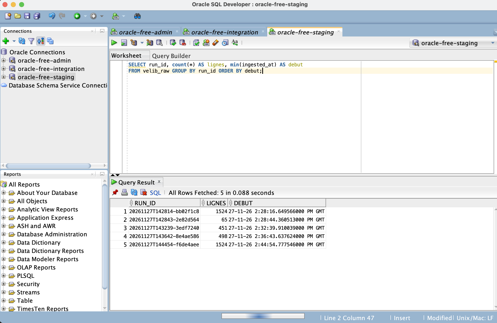
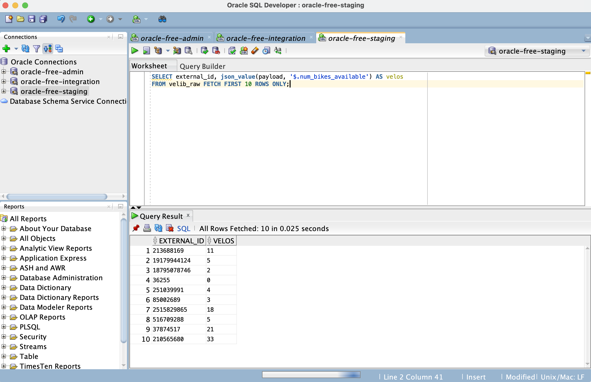

# TP 1 – Une table dans staging, alimentée par une API

**Nom :** Ganpat Patel · **Branche :** `tp-1`

Le TP est réparti sur deux dépôts :

| Dépôt | Contenu |
|---|---|
| [YNOV-CID-SQL](https://github.com/ganpat-patel-012/YNOV-CID-SQL/tree/tp-1) | Le squelette : `sql/staging/002_init_staging_velib.sql` |
| [YNOV-CID-INGESTION](https://github.com/ganpat-patel-012/YNOV-CID-INGESTION/tree/tp-1) (ce dépôt) | Le script : `staging/ingest_velib.py` |

Le SQL a été commité et poussé **avant** le Python : commit `9c5da43` « TP1: squelette staging »
(YNOV-CID-SQL, 27/11/2026 15:27:33) puis le script dans ce dépôt.

## 1. API choisie : Vélib' Métropole – état des stations

- **URL :** https://velib-metropole-opendata.smovengo.cloud/opendata/Velib_Metropole/station_status.json
- **Clé :** aucune.
- **Où est la liste :** sous `data.stations` (la racine contient `lastUpdatedOther`, `ttl`, `data`).
- **Champ identifiant :** `station_id` (1 524 stations, toutes avec un `station_id` unique).

Exemple d'objet :

```json
{"station_id": 213688169, "stationCode": "16107", "num_bikes_available": 11,
 "num_bikes_available_types": [{"mechanical": 10}, {"ebike": 1}],
 "num_docks_available": 24, "is_installed": 1, "is_renting": 1, "is_returning": 1,
 "last_reported": 1795786483, ...}
```

## 2. Commandes

**Appliquer le squelette** (une fois, dans SQL Developer, connexion `oracle-free-staging`) :
ouvrir `sql/staging/002_init_staging_velib.sql` du dépôt YNOV-CID-SQL et exécuter avec **F5**.
Résultat : `Table VELIB_RAW created.` ; `SELECT table_name FROM user_tables;` liste `VELIB_RAW`.

Le fichier s'appelle `002_…` et non `001_…` : dans ce dépôt, `001_init_staging.sql` contient
déjà la table `meteo_raw` de l'installation. On ne modifie jamais un script SQL déjà appliqué,
on en ajoute un nouveau, numéroté à la suite (principe des migrations).

**Lancer le script :**

```bash
python3 -m venv .venv
.venv/bin/pip install -r requirements.txt
cp .env.example .env        # puis renseigner les identifiants
.venv/bin/python staging/ingest_velib.py
```

Le fichier `.env` (ignoré par Git) contient `DB_USER`, `DB_PASSWORD`, `DB_DSN`.

## 3. Frontières du schéma (partie 2.3)

| Connexion | Requête | Résultat obtenu | Pourquoi |
|---|---|---|---|
| oracle-free-staging | `SELECT count(*) FROM velib_raw;` | `0` | La table lui appartient |
| oracle-free-admin | `SELECT count(*) FROM staging.velib_raw;` | `0` | L'administrateur voit tout |
| oracle-free-integration | `SELECT count(*) FROM staging.velib_raw;` | `ORA-00942: table or view "STAGING"."VELIB_RAW" does not exist` | La table existe, mais integration n'a pas le droit de la voir |

Le tableau ci-dessus a été relevé juste après la création de la table (vide). Captures
SQL Developer refaites après les ingestions, avec la même requête depuis les trois
connexions : staging et admin voient les **mêmes 4 062 lignes**, integration reçoit toujours
**ORA-00942**.

**oracle-free-staging** → `4062` (propriétaire de la table)



**oracle-free-admin** → `4062` (l'administrateur voit tout)



**oracle-free-integration** → `ORA-00942` (pas le droit de voir staging)



## 4. Trois lancements successifs

```
run 20261127T142814-bb02f1c8 : 1524 insérées, 0 doublons
run 20261127T142818-a446c67d : 0 insérées, 1524 doublons
run 20261127T142822-0403819c : 0 insérées, 1524 doublons
```

Le nombre de lignes ne bouge pas : chaque station a le même contenu, donc le même
`payload_hash`, et la contrainte `UNIQUE (source, external_id, payload_hash)` refuse l'INSERT
(ORA-00001), que le script compte comme doublon.

**Requête de preuve** (connexion staging) :

```sql
SELECT run_id, count(*) AS lignes, min(ingested_at) AS debut
FROM velib_raw
GROUP BY run_id
ORDER BY debut;
```

```
RUN_ID                     LIGNES  DEBUT
20261127T142814-bb02f1c8   1524    27/11/26 14:28:16,649566
20261127T142843-2e82d564   65      27/11/26 14:28:44,360513
```

Les lancements 2 et 3 n'apparaissent pas : ils n'ont inséré aucune ligne. La ligne `…2e82d564`
est le lancement fait après la panne (partie 5) : entre-temps, 65 stations avaient changé
(vélos pris ou rendus), elles sont entrées comme nouvelles lignes. C'est voulu : le staging
accumule l'historique, seuls les contenus identiques sont refusés.

**Résultat en fin de séance** (capture SQL Developer, connexion staging) – 5 run_id ont
inséré des lignes, 4 062 lignes au total pour 1 524 stations distinctes :



| run_id | lignes | explication |
|---|---|---|
| `…bb02f1c8` | 1 524 | premier lancement : toutes les stations |
| `…2e82d564` | 65 | relance après la panne : stations qui avaient changé |
| `…3edf7240` | 451 | relance 4 min plus tard (vérification après réorganisation du dépôt) |
| `…8e4ae586` | 498 | relance 4 min plus tard (vérification de la grille) |
| `…f6de4aee` | 1 524 | **l'API a changé de format**, voir ci-dessous |

Tous les lancements immédiatement consécutifs (2e et 3e de chaque série) ont donné
`0 insérées, 1524 doublons` et n'apparaissent donc pas dans le GROUP BY.

### Observation : l'API a changé de format pendant le TP

Le run `…f6de4aee` (14:44 UTC) a réinséré **les 1 524 stations**, alors que les autres
relances n'en inséraient que quelques centaines. En comparant chaque payload avec la
version précédente de la même station, **aucun n'était identique** :

| Champ | Stations où il a changé | Avant | À 14:44 |
|---|---|---|---|
| `stationCode` | 1 524 | `"16107"` | **absent** |
| `num_bikes_available_types` | 1 524 | `[{"mechanical": 10}, {"ebike": 1}]` | `[{}, {}]` |
| `num_bikes_available` | 637 | (vélos pris ou rendus, normal) | |

L'API Vélib' a renvoyé pendant quelques minutes une réponse dégradée (code station absent,
détail mécanique / électrique vide). À 15:51, elle était revenue au format normal.

Ce que ça montre :
- **Le staging a fait son travail** : on stocke le brut, donc on a la preuve exacte de ce
  que l'API a renvoyé et quand (`ingested_at`). Si on avait choisi nos colonnes à l'avance,
  on aurait simplement eu des valeurs vides, sans pouvoir expliquer pourquoi.
- **L'idempotence n'a pas été prise en défaut** : le contenu était réellement différent,
  donc ces lignes sont légitimement nouvelles. Le hash protège contre les relances, pas
  contre une source qui change.
- **C'est le travail de la couche integration** : elle devra détecter ces réponses dégradées
  (ex. `stationCode` absent) et les écarter ou les signaler, sans toucher au staging.

Requête de vérification :

```sql
SELECT run_id, json_value(payload, '$.stationCode') AS code,
       json_query(payload, '$.num_bikes_available_types') AS types
FROM velib_raw
WHERE external_id = '213688169'
ORDER BY ingested_at;
```

**Le brut reste interrogeable :**

```sql
SELECT external_id,
       json_value(payload, '$.num_bikes_available') AS valeur,
       ingested_at
FROM velib_raw
WHERE run_id = '20261127T142814-bb02f1c8'
FETCH FIRST 10 ROWS ONLY;
```

```
EXTERNAL_ID   VALEUR  INGESTED_AT
213688169     11      27/11/26 14:28:16,649566
19179944124   5       27/11/26 14:28:16,731492
18795078746   2       27/11/26 14:28:16,737927
36255         0       27/11/26 14:28:16,740438
251039991     4       27/11/26 14:28:16,741814
85002689      3       27/11/26 14:28:16,743107
2515829865    18      27/11/26 14:28:16,744479
516709288     5       27/11/26 14:28:16,745384
37874517      21      27/11/26 14:28:16,745902
210565680     33      27/11/26 14:28:16,746316
```

Capture SQL Developer (le nombre de vélos lu directement dans le JSON brut) :



Aucun `external_id` vide (`SELECT count(*) … WHERE external_id IS NULL` → 0).

## 5. Casser quelque chose (partie 3.2)

Test : URL remplacée par `…/station_status_WRONG.json`, puis relance.

**Le script a-t-il planté ?** Oui, immédiatement, code de sortie 1 :

```
requests.exceptions.HTTPError: 404 Client Error: Not Found for url:
https://velib-metropole-opendata.smovengo.cloud/opendata/Velib_Metropole/station_status_WRONG.json
```

`raise_for_status()` transforme la réponse 404 en exception dans `fetch()`, avant tout accès
à la base.

**Qu'y a-t-il dans la base pour ce run_id ?** Rien. `store()` n'a jamais été appelée : aucune
ligne, la table est restée à 1 524 lignes et 1 seul run_id. Même si l'erreur était arrivée
pendant la boucle d'insertion, le commit unique en fin de `store()` garantit « tout ou rien ».

**Que ferais-je demain matin en voyant l'erreur ?**
1. Lire le message : un 404 signifie que l'URL n'existe plus (endpoint déplacé ou renommé),
   ce n'est pas une panne passagère ; un timeout ou un 5xx serait plutôt temporaire.
2. Tester l'URL à la main (navigateur / `curl`) et vérifier la documentation de l'API.
3. Corriger l'URL et relancer : c'est sans danger, car le script est idempotent.
4. Accepter le trou dans l'historique : l'API Vélib' ne donne que l'état actuel, l'état
   des stations pendant la panne est perdu.

**Après correction de l'URL :** `run 20261127T142843-2e82d564 : 65 insérées, 1459 doublons`.
1 459 stations inchangées sont refusées, 65 stations modifiées entrent : cohérent avec
1 524 stations.

## 6. Pour aller plus loin

**Un test** – `tests/test_idempotence.py` appelle `store()` deux fois avec le même objet
(une station factice `TEST-…`) et vérifie qu'une seule ligne existe, puis qu'un contenu
modifié entre bien comme nouvelle ligne. Il supprime ses lignes à la fin.

```
$ .venv/bin/python tests/test_idempotence.py
OK : 2 appels identiques -> 1 ligne ; contenu modifié -> nouvelle ligne ; nettoyage fait
```

**Pagination** – l'API `station_status.json` de Vélib' n'est pas paginée : un seul appel
renvoie les 1 524 stations. Elle indique en revanche sa fraîcheur : `lastUpdatedOther`
(horodatage de la dernière mise à jour) et `ttl` (durée de validité, en secondes).

**Une deuxième source** – `staging.meteo_raw` (Open-Meteo, `staging/ingest_meteo.py`) est
déclarée dans un fichier séparé, `001_init_staging.sql`, et `velib_raw` dans `002_…`.
Pourquoi un nouveau fichier plutôt que modifier l'ancien : un script déjà appliqué sur une
base ne sera pas rejoué ; le modifier crée un écart entre ce que dit Git et ce qui existe
réellement. Un nouveau fichier numéroté garde l'historique et permet à n'importe qui de
reconstruire la même base en appliquant `000`, `001`, `002` dans l'ordre.

**Métadonnées HTTP** – non implémenté. Une colonne `response_meta JSON` (code HTTP, en-têtes
`Date`, `Last-Modified`, `ETag`…) servirait à diagnostiquer une source (quand a-t-elle
commencé à répondre autrement ?), à prouver ce que l'API a renvoyé et quand, et à éviter
de retélécharger une réponse inchangée (requête conditionnelle avec `ETag`). Elle s'ajouterait
par un nouveau script `003_…sql` avec `ALTER TABLE`, jamais en modifiant le `002`.

## Organisation : un dossier par couche

```
.
├── staging/                  <- ingestion : API -> staging.<source>_raw
│   ├── ingest_velib.py       <- TP 1 (fetch() ne connaît pas la base, store() ne connaît pas l'API)
│   └── ingest_meteo.py       <- exemple de l'installation
├── integration/              <- transformations staging -> integration (vide pour l'instant)
├── mart/                     <- tables métier integration -> mart (vide pour l'instant)
├── tests/test_idempotence.py <- store() deux fois -> une seule ligne
├── docs/screenshots/         <- captures SQL Developer (frontières du schéma)
├── .env.example              <- modèle du fichier .env (sans vrai mot de passe)
└── requirements.txt
```
